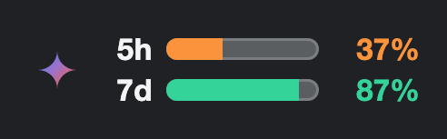
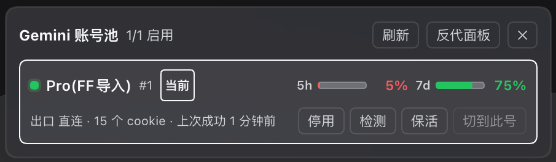

# dsh-gemini-quota

在 **DeepSeek Harness** 输入框那一行显示一条 Gemini 额度小条，**点一下弹出多号池面板**。



- 只在**当前选中的模型属于 Gemini** 时出现，切到 DeepSeek / Codex 自动消失；
- 鼠标悬停显示剩余量与重置时间（含账号），**提示气泡跟随 DSH 主题配色**（明暗主题与皮肤插件都会同步）；
- **0.2.0 新增账号池面板**：点一下额度条，逐个账号看 5h / 7d 剩余额度，并能直接
  **启用 / 停用（冷却）/ 检测登录态 / 保活 / 切号**——不用切去反代后台网页；
- 数据来自本地 `gemini-web2api-go` 反代的 `/admin/api/*`。

> 本插件是**显示 + 控制层**，不含反代本身。你需要先自己跑一个
> [gemini-web2api-go](https://github.com/zexadev/gemini-web2api-go)。
>
> **注意**：上游 v4.22.0 **没有** `GET /admin/api/quota` 这个接口——它是本机对上游的
> 本地补丁（`internal/app/quota.go`，**上游升级会被覆盖，需备份**）。没有它，
> 额度条永远不显示（路由返回 502），但**账号池面板仍然可用**（它只依赖上游已有的
> `/admin/api/cookies`）。
>
> 账号池面板里的**逐号额度**另需一个本地扩展：`GET /admin/api/quota?account_id=N`。
> 没打这个补丁时，面板会明确标出「按号查额度不支持」，不会拿自动选号的数字冒充某个账号。

## 前置条件

1. 一个在跑的反代，默认地址 `http://127.0.0.1:8083`；
2. 它的 admin token，放在下面任一位置（按优先级）：
   - `token` 配置项（直接写在 config 里，不推荐提交到仓库）；
   - 环境变量 `GEMINI_WEB_ADMIN_TOKEN`（可用 `tokenEnv` 改名）；
   - `envFile` 指向的文件里的 `GEMINI_WEB_ADMIN_TOKEN=...`；
   - **`$DSH_HOME/gemini-web2api.env`**（默认 `~/.dsh/gemini-web2api.env`）——推荐，机器相关的东西放这里。

   ```sh
   install -m 600 /dev/null ~/.dsh/gemini-web2api.env
   printf 'GEMINI_WEB_ADMIN_TOKEN=%s\n' '<你的 admin token>' > ~/.dsh/gemini-web2api.env
   ```

## 安装

在 DSH 侧边栏 **插件** 页里安装（输入包名即可）：

```
dsh-gemini-quota
```

也可以走 CLI / 其他 spec 形式：

```sh
# 注册表包
dsh plugin --profile <profile> add dsh-gemini-quota
# 本地目录（开发用）
dsh plugin --profile <profile> add /path/to/dsh-gemini-quota
# tarball / git
dsh plugin --profile <profile> add ./dsh-gemini-quota-0.2.0.tgz
dsh plugin --profile <profile> add github:xinglan163/dsh-gemini-quota
```

安装后默认启用。本插件**没有任何依赖构建脚本**，因此不会触发 pnpm 的 `allowBuilds` 审批。

## 配置

改组合包自带的 `cordis.patch.yml`，或在你 profile 的 `cordis.patch.yml` 里按 `id: gemini-web-quota` 覆盖：

| 项 | 默认 | 说明 |
|---|---|---|
| `baseUrl` | `http://127.0.0.1:8083` | 反代地址 |
| `providers` | `["gemini-web"]` | 哪些 DSH provider id 触发显示（决定门控） |
| `matchModelPrefix` | `true` | 额外按模型名 `gemini-*` 兜底 |
| `token` | — | 直接给 admin token（优先级最高） |
| `tokenEnv` | `GEMINI_WEB_ADMIN_TOKEN` | 从哪个环境变量读 token |
| `envFile` | `$DSH_HOME/gemini-web2api.env` | 从该文件读 token |
| `timeoutMs` | `8000` | 上游超时 |
| `readOnly` | `false` | `true` = 面板只读，禁用一切账号动作 |

`providers` 必须和你在 `llm-pi-ai` 里给反代起的 provider 名一致（默认 `gemini-web`）。

## 账号池面板（0.2.0）

额度条**点一下**弹出面板（再点 / 点外面 / 按 Esc 关闭）：



```
Gemini 账号池   1/2 启用                     [刷新] [反代面板] [✕]
● Pro(FF导入) #1  [当前]   5h ▓▓▓▓ 100%   7d ▓▓▓ 80%
  出口 直连 · 15 个 cookie · 上次成功 2 小时前   [停用][检测][保活][切到此号]
● 备用号 #2                5h ░░░░ 0%       7d ▓▓▓ 55%
  出口 新加坡 · 失败 3 次 · 上次成功 1 天前      [启用][检测][保活][切到此号]
```

| 元素 | 含义 |
|---|---|
| `●` 颜色 | 绿=在用；黄=待检测（还没成功用过）；红=鉴权失败中（多半 cookie 过期）；灰=已停用 |
| `[当前]` | 额度条上显示的正是这个号（取反代自动选号的结果） |
| `5h / 7d` | 该账号自己的网页端额度（`?account_id=N`），失败时显示原因，不支持时显示 `—` |
| 第二行 | 出口代理、失败计数、cookie 个数、上次成功时间（悬停看完整 `last_error`） |
| `启用 / 停用` | 即"冷却"开关：停用的号不会被调度器选中 |
| `检测` | 真的去上游探一次登录态（`/check`），结果直接显示在下方 |
| `保活` | 刷新 cookie（`/rotate`，SAPISID 轮换），返回刷新了哪几个字段 |
| `切到此号` | **需点两次确认**：启用目标号，并停用其余已启用的号 |

**「切到此号」为什么要点两次**：反代的调度器只按 `(fail_count, last_used_at)` 轮转，
没有「活跃账号」这个开关，所以"让接下来的请求都走这个号"唯一诚实的实现就是
**把别的号禁用掉**——这是会一次改动多行的动作，值得一次确认。

「反代面板」按钮会新开 `baseUrl/admin/`（反代自带的 web 面板），加 cookie / 配代理这类
不常做的事还是去那边。

## 宿主路由

| 路由 | 上游 | 说明 |
|---|---|---|
| `GET /plugins/dsh-gemini-quota/quota[?account_id=N][?refresh=1]` | `GET /admin/api/quota` | 额度条数据；`account_id` 是面板逐号查的入口 |
| `GET /plugins/dsh-gemini-quota/pool` | `GET /admin/api/cookies` | 账号池视图（健康度、失败计数、代理、cookie 摘要） |
| `POST /plugins/dsh-gemini-quota/account` | `POST /admin/api/cookies/{id}/{toggle\|check\|rotate}` | 账号动作；`switch` 由插件编排（启用目标 + 停用其余） |

`sapisid_tail` 之类的摘要字段来自反代；**完整 cookie 值不会出现在任何回给浏览器的数据里**。

## 工作原理

- **宿主半**（`index.js`）把反代 `/admin/api/*` 转成同源路由 `/plugins/dsh-gemini-quota/*`。
  为什么不让浏览器直连反代：反代的 CORS 预检没有 `Access-Control-Allow-Headers`，带
  `Authorization` 的 fetch 会被浏览器拒；用 `?token=` 又能过但会把 admin token 泄进前端产物。
- 三条路由都自带最小信任闸门（回环对端 + 回环 Host + 非 cross-site + 同源 Origin），
  `POST /account` 另有 `readOnly` 开关和入参校验。
- 面板的逐号额度是**打开面板时才按需并发查**（3 个 worker），一旦发现反代不支持
  `?account_id=N` 就立刻停手并如实标注，不白打上游。
- 路由同时下发 `providers` / `matchModelPrefix`：浏览器半拿不到 cordis config
  （client-modules 只传 `{ name: id }`），所以门控范围必须由宿主告知。

## 自测

```sh
node --check index.js && node --check client.js
node selftest.mjs              # 宿主半：路由/闸门/token 链/字段映射 + 浏览器半模块契约冒烟
node scripts/http-check.mjs    # 真起一个 http server，用真 fetch 打一遍三条路由
```

反代没在跑时依赖上游的用例会标 SKIP 而不是失败。

## 疑难排查

| 现象 | 原因 |
|---|---|
| 悬停提示正常但**条一直不出现** | 当前模型不在 `providers` 里；改配置或开 `matchModelPrefix` |
| 控制台/路由 503 `no admin token` | token 四个来源都没命中 |
| 502 `upstream ...` | 反代没跑、端口不对、或 admin token 无效 |
| 面板整行都显示 `—` 并提示「按号查额度不支持」 | 反代的 `/admin/api/quota` 没打 `?account_id=N` 扩展（见文件头说明） |
| 403 `forbidden` | 不是从回环地址/同源访问的 |
| 点「停用」提示 403 `readOnly` | 宿主配置里把 `readOnly` 设成了 `true` |
| 切号后发现请求还是走旧号 | 调度器每请求取一次号；已在飞的请求不会中断，下一条新请求才走新号 |
| 改了 `client.js` 界面没变 | `client-hmr` 对 `link:` 安装不一定生效，**刷新页面（Cmd+R）**最稳 |
| 改了 `index.js`（宿主半）界面没变 | 宿主半没有 HMR：需要**重启 DSH**（或插件页关掉再开启该组合包） |
| 刚发布的新版装不上（`Already up to date`） | pnpm「最小发布年龄」保护：加 `--config.minimumReleaseAge=0`，或等一段时间 |

## 卸载

插件页关掉组合包，或 `dsh plugin --profile <profile> remove dsh-gemini-quota`。

## License

MIT
